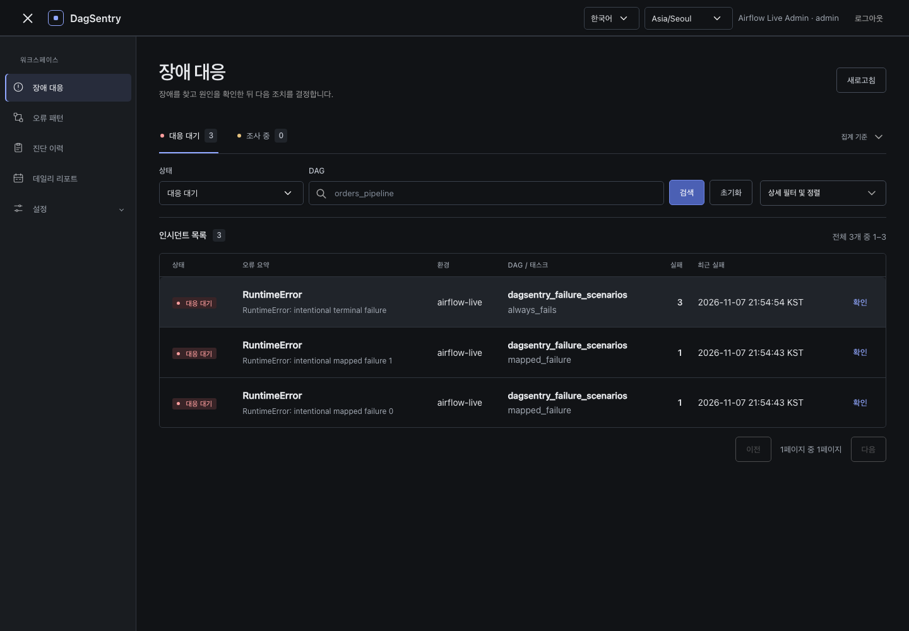
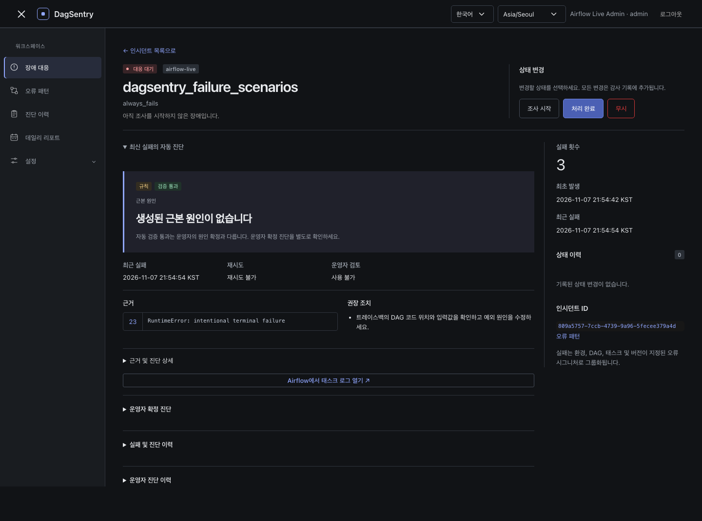

# Airflow 실제 연동 검증

Airflow 3.3.1에서 저장소의 `dagsentry_failure_scenarios`를 실행했다. API 응답 fixture나 사전 생성 Incident를 사용하지 않았다. 실제 Airflow Task Try 로그를 Public REST API로 읽어 규칙 진단을 저장했다.

접속 주소와 호스트명은 개인정보 보호를 위해 문서용 예시(`192.0.2.10`, `worker.example.invalid`)로 익명화했다. 실행 결과와 관찰 사실은 그대로 유지했다.

| 서비스 | 익명화한 접속 주소 |
| --- | --- |
| Airflow | http://192.0.2.10:8082 |
| 실제 연동 DagSentry | http://192.0.2.10:8091/ui/ |

별도 Airflow 홈과 두 테스트 DB는 `/private/tmp/dagsentry-airflow-live-20261107`에 있다. 기존 8011 UI 데모와 데이터를 공유하지 않는다. 검증 당시 DagSentry API, Worker, Airflow standalone과 localhost 알림 수신기를 실행했다. 프로세스 ID는 해당 폴더의 `pids.json`에 있다. 인증 토큰은 권한 0600인 로컬 설정에만 저장했다.

실행 ID는 `dagsentry_live_20261107T125439`다. 의도적으로 실패하는 Task가 있어 DAG Run의 최종 `FAILED`는 예상 결과다.

| 검증 | 관찰 결과 |
| --- | --- |
| 재시도 후 복구 | 첫 Try 실패, 두 번째 Try 성공. Recovery Checker가 Incident를 RECOVERED로 변경 |
| 최종 실패 | 세 Try 실패를 하나의 Incident로 연결 |
| 매핑 실패 | map index 0과 1을 각각 수집. 서로 다른 오류 메시지로 별도 시그니처·Incident 생성 |
| 수집 | 이벤트 6건. RETRY_CALLBACK 3건, LISTENER 3건 |
| 진단 | RULE/PASSED 6건, DAG_CODE 분류, 실제 로그 근거와 권장 조치 저장 |
| Worker | Outbox 작업 6건 모두 첫 시도에 COMPLETED |
| 중복 전송 | 같은 이벤트 재전송 시 created=false. 이벤트와 작업 수가 각각 6건으로 유지 |
| 알림 | 장애 알림 5건 전달, 반복 알림 1건 억제, 복구 알림 1건 전달. 모두 로컬 수신기 사용 |
| Incident | 총 4건. OPEN 3건, RECOVERED 1건 |
| 실제 UI | 목록·상세·실패 이력, 모바일 화면, Airflow 로그인 후 해당 Task의 실제 로그 이동 확인 |

LLM은 연결하지 않았다. AI 원인 설명과 외부 알림 서비스는 미검증이다. 규칙 진단은 분류·근거·권장 조치를 제공하며 이 실행의 root_cause 필드는 비어 있다. UI는 이를 생성된 원인이 없는 상태로 표시한다. DB는 로컬 테스트용 SQLite를 사용했다. PostgreSQL 운영 구성 검증은 아니다.

`Prove It Works` 원칙에 따라 실제 API·저장값·브라우저를 대조했다. `Separate Before Serializing Shared State` 원칙에 따라 기존 데모와 테스트 상태를 별도 디렉터리와 DB로 분리했다.

결과는 [result.json](result.json), 실제 Task 상태는 [tasks.json](tasks.json), 최종 실행 상태는 [run-final.json](run-final.json), 복구 결과는 [recovery-result.txt](recovery-result.txt)에 있다.

Airflow Task의 실제 로그 이동은 확인했다. 해당 화면 캡처는 로컬 사용자 경로가 노출되어 공개 자료에서 제외했다.
